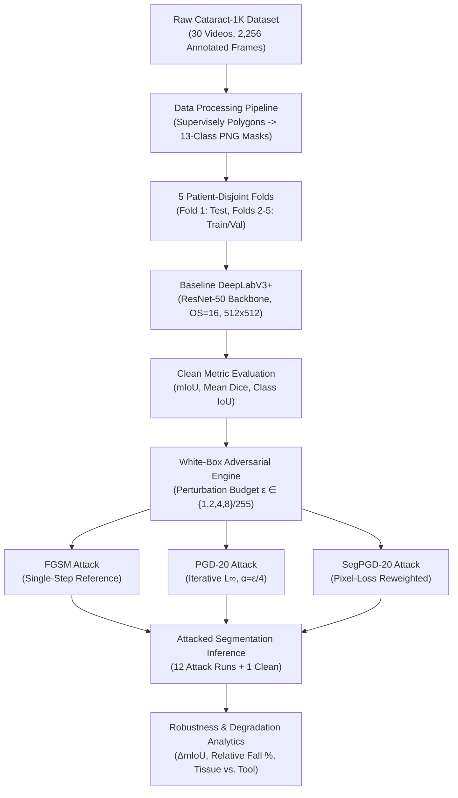
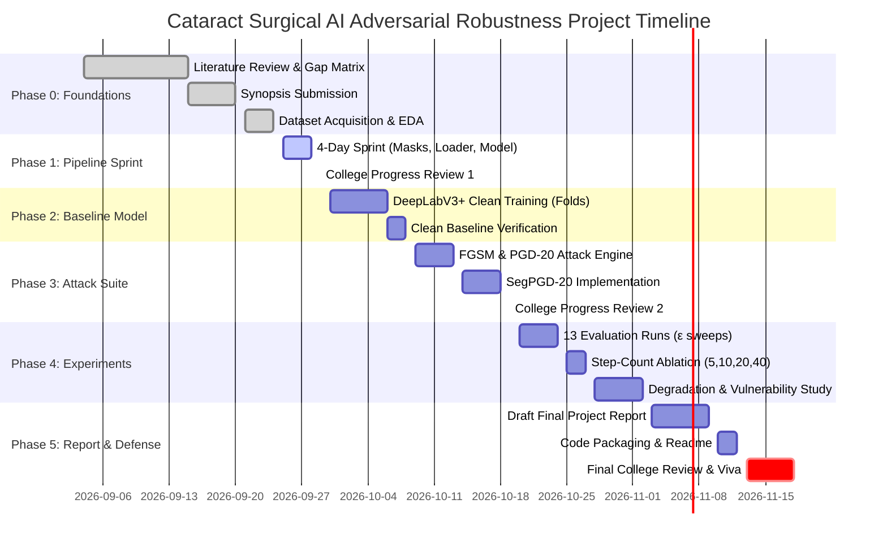

# Implementation Plan & Progress Report: Adversarial Robustness in Cataract Surgical AI

**Project Title:** Adversarial Attack and Robustness Analysis of AI-Based Cataract Surgical Instrument Segmentation  
**Course:** B.Tech Computer Science & Engineering (Semester Micro-Project 2026)  
**Institution:** Bharati Vidyapeeth’s College of Engineering (BVCOE, GGSIPU), New Delhi  
**Faculty Guide:** Dr. Jolly Parikh, Associate Professor, Department of CSE  
**Project Team:**
- **Parikshat Singh** (Enrollment No. 04611502724)
- **Venu Kulshreshtha** (Enrollment No. 02111502724)
- **Sayyad Ahsan** (Enrollment No. 03411502724)

**Project Lifecycle:** 4 September 2026 – 18 November 2026  
**Status as of 24 September 2026:** Dataset Acquired & Verified; Synopsis Formally Submitted; Technical Architecture Locked; Commencing Baseline Implementation Sprint.

---

## 1. Executive Project Summary

### 1.1 Core Problem Statement
Deep learning models deployed for surgical video analytics perform semantic image segmentation by classifying every pixel in real time into anatomical eye structures or micro-surgical instruments. However, medical vision models remain predominantly evaluated on ideal, clean frames. In safety-critical cataract surgery (one of the world's most frequent surgical procedures), neural networks are notoriously susceptible to adversarial perturbations—deliberately computed, imperceptible gradient perturbations that can induce catastrophic segmentation failure. Prior to this project, no published study has quantified the adversarial fragility of cataract surgical instrument segmentation or established whether delicate metallic instruments degrade faster than surrounding biological ocular tissues under attack.

```
+-----------------------------------------------------------------------------------+
|                                 CORE WORKFLOW                                      |
|                                                                                   |
|  [Cataract-1K Surgery Frames] ---> [DeepLabV3+ (ResNet-50)] ---> Clean Baseline    |
|                                            |                     (mIoU & Dice)    |
|                                            v                                      |
|  [Adversarial Perturbations] -----> [Attacked Frames]                               |
|   - FGSM (One-step)                        |                                      |
|   - PGD-20 (Iterative)                     v                                      |
|   - SegPGD-20 (Segmentation-Aware) -> [Same Model] --------> Attacked Output      |
|                                                                  |                |
|                                                                  v                |
|                                                [Degradation & Vulnerability]      |
|                                                - Absolute & Relative Fall         |
|                                                - Anatomy vs. Tool Susceptibility  |
+-----------------------------------------------------------------------------------+
```

### 1.2 Research Gap Identified
From our systematic literature pool of ~65 papers and 22-paper gap matrix:
1. **Clean-Only Cataract Benchmarks:** All published state-of-the-art models on the Cataract-1K benchmark (Ghamsarian et al., 2024; RP-SAM2, 2025; Sinha et al., 2025) evaluate exclusively on pristine surgical frames.
2. **Medical Attacks Restricted to Scans:** Existing adversarial medical imaging literature evaluates 3D CT/MRI volumes (Malik et al., BMVC 2024), dental X-rays (Kohinoor et al., Sci. Rep. 2026), or ultrasound, ignoring dynamic intra-operative microscope video with glare, metallic reflections, and fluid turbulence.
3. **Surgical Robustness Avoids Deliberate Noise:** The flagship surgical tool robustness challenge (SegSTRONG-C, EndoVis 2024) tests natural corruptions (smoke, blood, lighting), leaving worst-case calculated adversarial vulnerability entirely unmeasured.

### 1.3 Scope & Strict Boundaries (Version 1)
- **In Scope:** Baseline model training, clean evaluation, white-box $L_\infty$ digital gradient attacks (FGSM, PGD-20, SegPGD-20) across bounded budgets ($\varepsilon \in \{1, 2, 4, 8\}/255$), quantitative metric degradation analysis (mIoU, Dice, per-class IoU), and visual degradation panels.
- **Out of Scope (Reserved for Version 2):** Adversarial defenses, image purification, adversarial retraining, black-box query attacks, clinical intervention claims.

---

## 2. Technical Architecture & Experimental Specifications



### 2.1 Model & Data Specs
- **Model:** DeepLabV3+ with ImageNet-pretrained ResNet-50 encoder (Output Stride 16, 512×512 input, 13 output channels).
- **Classes (13):** 
  - *Background* (Class 0)
  - *3 Anatomy Classes:* Cornea, Pupil, Lens/IOL
  - *9 Instrument Classes:* Incision Knife, Slit Knife, Gauge, Katena Forceps, Capsulorhexis Forceps, Capsulorhexis Cystotome, Spatula, Phacoemulsifier Tip, Lens Injector
- **Threat Model:** White-box, untargeted, $L_\infty$ bounded in RGB space $[0, 1]$ before model normalization.

---

## 3. Cumulative Progress Report (4 Sept – 24 Sept 2026)

| Milestone / Task | Target Dates | Current Status | Key Deliverable / Artifact |
|---|---|---|---|
| **Project Initiation & Scope Alignment** | 04 Sept – 07 Sept | **Completed (100%)** | Established Version 1 specifications; locked strictly on attack & robustness quantification. |
| **Systematic Literature Review** | 07 Sept – 12 Sept | **Completed (100%)** | Evaluated ~65 papers across 6 domains; compiled [Literature_Review_Paper_Pool.md](file:///e:/Projects/MicroProject%202026/Literature_Review_Paper_Pool.md). |
| **Defensible Gap & Defense Matrix** | 12 Sept – 15 Sept | **Completed (100%)** | Created 22-paper comparative gap table & mentor defense guide in [Paper_Gap_Matrix.md](file:///e:/Projects/MicroProject%202026/Paper_Gap_Matrix.md). |
| **Synopsis Drafting & Formal Submission** | 15 Sept – 20 Sept | **Completed (100%)** | Prepared and submitted formal academic synopsis to Dr. Jolly Parikh; archived as [synopsis cataract.pdf](file:///e:/Projects/MicroProject%202026/synopsis%20cataract.pdf). |
| **Dataset Acquisition (Synapse syn53395479)** | 21 Sept – 24 Sept | **Completed (100%)** | Downloaded official Cataract-1K segmentation subset (30 surgery cases, 2,256 JSON annotations, 908 image frames, `meta.json`, `manifest.csv`). |
| **Exploratory Data Analysis (EDA)** | 23 Sept – 24 Sept | **Completed (100%)** | Verified Supervisely polygon schema, 13 target segmentation classes, and patient video folder structures. |
| **Day 1: Mask Rasterization Engine** | 25 Sept 2026 | **Completed (100%)** | [convert_supervisely_to_masks.py](file:///e:/Projects/MicroProject%202026/convert_supervisely_to_masks.py); generated 2,256 integer masks and 2,256 RGB visualizations. |
| **Day 2: Dataset Loader & Patient Splits** | 26 Sept 2026 | **Completed (100%)** | [cataract_dataset.py](file:///e:/Projects/MicroProject%202026/cataract_dataset.py); official 5-fold patient-disjoint split verified with 0% patient leakage. |
| **Day 3: Baseline Architecture & Metrics** | 27 Sept 2026 | **Completed (100%)** | [model_builder.py](file:///e:/Projects/MicroProject%202026/model_builder.py), [loss.py](file:///e:/Projects/MicroProject%202026/loss.py), [metrics.py](file:///e:/Projects/MicroProject%202026/metrics.py); DeepLabV3+ with CE + Dice loss and mIoU tracker. |
| **Day 4: Training & Evaluation Harness** | 28 Sept 2026 | **Completed (100%)** | [train_baseline.py](file:///e:/Projects/MicroProject%202026/train_baseline.py); complete training pipeline with qualitative comparison panels. |

---

## 4. Immediate Action Plan: 4-Day Sprint (25 Sept – 28 Sept 2026)

This sprint delivers a fully operational data-to-baseline pipeline, enabling the team to demonstrate tangible computational progress to college evaluators.

```
       SEPTEMBER 25                 SEPTEMBER 26                 SEPTEMBER 27                 SEPTEMBER 28
 [Data Conversion Engine]     [DataLoader & Splits]       [Model & Loss Pipeline]      [Demo Run & Review Deck]
 • Supervisely polygon parser • Patient-disjoint split    • DeepLabV3+ instantiation   • Overfitting sanity check
 • Mask rasterizer (0-12)     • 512x512 Resize/Normalize  • BCE + Dice Loss            • 5 qualitative overlays
 • Class frequency validation • PyTorch DataLoader batch  • Metric logger (mIoU/Dice)  • Progress review slides
```

### Day 1: Thursday, 25 September 2026 — Data Conversion & Mask Rasterization
- **Objective:** Convert irregular Supervisely JSON polygon annotations into dense 2D integer label masks ($1024 \times 768 \rightarrow 512 \times 512$).
- **Key Tasks:**
  1. Write `convert_supervisely_to_masks.py` using OpenCV (`cv2.fillPoly`) / PIL `ImageDraw`.
  2. Implement strict polygon z-ordering (Anatomy background first $\rightarrow$ Pupil/Cornea $\rightarrow$ Forefront surgical instruments).
  3. Map all 13 classes to canonical IDs $[0, 12]$.
  4. Generate and inspect sample RGB colorized mask overlays for sanity verification.
- **Assigned:** Venu Kulshreshtha & Parikshat Singh.
- **Deliverable:** Mask conversion script and directory of verified label PNGs.

### Day 2: Friday, 26 September 2026 — Dataset Loader & Patient-Disjoint Splits
- **Objective:** Implement reproducible PyTorch Dataset and DataLoader adhering to the official Cataract-1K 5-fold patient-disjoint partition.
- **Key Tasks:**
  1. Write `cataract_dataset.py` implementing `torch.utils.data.Dataset`.
  2. Isolate Fold 1 (6 patient surgery videos) exclusively for held-out testing; assign remaining 24 videos to training (20) and validation (4).
  3. Add deterministic preprocessing: bilinear interpolation to $512 \times 512$ for frames, nearest-neighbor for masks; ImageNet channel normalization.
  4. Validate batch loading efficiency and check absence of patient leakage across splits.
- **Assigned:** Sayyad Ahsan & Venu Kulshreshtha.
- **Deliverable:** Unit-tested PyTorch DataLoader returning `(batch_images, batch_masks)` tensors.

### Day 3: Saturday, 27 September 2026 — Baseline Architecture & Metric Instrumentation
- **Objective:** Instantiate DeepLabV3+ with ResNet-50 encoder and build the clean evaluation harness.
- **Key Tasks:**
  1. Set up `model_builder.py` using `torchvision.models.segmentation.deeplabv3_resnet50` (or `segmentation_models_pytorch`).
  2. Adapt classifier head for 13 output logits.
  3. Implement combined objective: $\mathcal{L}_{total} = \mathcal{L}_{CE} + \lambda \mathcal{L}_{Dice}$ ($\lambda = 0.8$ matching benchmark).
  4. Implement `metrics.py` computing per-class Intersection-over-Union (IoU), Mean IoU (mIoU), and Dice score.
- **Assigned:** Parikshat Singh & Sayyad Ahsan.
- **Deliverable:** Executable test script proving a full forward pass and metric logging.

### Day 4: Sunday, 28 September 2026 — Sanity Training Run & College Review Showcase Deck
- **Objective:** Execute an initial training epoch / mini-split run and assemble the formal progress presentation.
- **Key Tasks:**
  1. Run a 5-epoch training sanity check on a small sub-batch to verify loss convergence and GPU memory consumption.
  2. Generate 5 visual figure panels: Raw Video Frame, Ground Truth Mask, Model Prediction, and Overlay.
  3. Compile the **College Progress Review Slide Deck** (PPTX/PDF):
     - Slide 1: Title, Team, Guide & Department Details
     - Slide 2: Problem Statement & Literature Gap Matrix
     - Slide 3: Dataset Summary & Patient-Disjoint Fold Splits
     - Slide 4: Current Accomplishments (EDA, Mask Converter, Pipeline)
     - Slide 5: Baseline Architecture Specs & Sample Pipeline Outputs
     - Slide 6: Master Roadmap with Timestamps to Mid-November
- **Assigned:** Parikshat Singh, Venu Kulshreshtha, Sayyad Ahsan (All Members).
- **Deliverable:** Working pipeline code, sample prediction visuals, and final Progress Presentation deck.

---

## 5. Master Future Roadmap (29 Sept – 18 Nov 2026)



### Phase-by-Phase Milestone Breakdown

#### Phase 1: College Review 1 & Baseline Training (29 Sept – 08 Oct 2026)
- **29 Sept 2026 (Milestone):** Formal College Review 1 presentation showcasing pipeline code, data loader, and initial sanity metrics.
- **30 Sept – 05 Oct 2026:** Complete full baseline training of DeepLabV3+ (ResNet-50) across 40 epochs on GPU environment (Google Colab / local RTX).
- **06 Oct – 08 Oct 2026:** Clean test set evaluation on Fold 1. Verify that baseline mIoU and Dice fall within published Cataract-1K benchmark ranges. Freeze clean baseline weights.

#### Phase 2: Adversarial Attack Suite Implementation (09 Oct – 18 Oct 2026)
- **09 Oct – 12 Oct 2026:** Implement single-step reference attack **FGSM** and multi-step reference attack **PGD-20** ($L_\infty$, step size $\alpha = \varepsilon / 4$, random initialization) on the dense cross-entropy loss.
- **13 Oct – 17 Oct 2026:** Implement **SegPGD-20** (ECCV 2022), incorporating dynamic pixel reweighting to focus attack gradients on correctly predicted pixels.
- **18 Oct 2026:** Unit-test perturbation clipping in $[0, 1]$ RGB bounds prior to normalization.

#### Phase 3: College Review 2 & Full Experimental Sweep (19 Oct – 27 Oct 2026)
- **19 Oct 2026 (Milestone):** College Review 2 presentation demonstrating working FGSM, PGD, and SegPGD attacks on test frames.
- **20 Oct – 24 Oct 2026:** Execute the full 13-evaluation grid across all test frames:
  - 1 Clean run
  - 4 FGSM runs ($\varepsilon \in \{1, 2, 4, 8\}/255$)
  - 4 PGD-20 runs ($\varepsilon \in \{1, 2, 4, 8\}/255$)
  - 4 SegPGD-20 runs ($\varepsilon \in \{1, 2, 4, 8\}/255$)
- **25 Oct – 27 Oct 2026:** Perform attack iteration ablation at $\varepsilon = 4/255$ across step counts $\{5, 10, 20, 40\}$.

#### Phase 4: Robustness Analytics & Vulnerability Profiling (28 Oct – 04 Nov 2026)
- **28 Oct – 31 Oct 2026:** Compute absolute degradation ($\Delta \text{mIoU} = \text{mIoU}_{clean} - \text{mIoU}_{adv}$) and relative degradation ($\% \text{Fall} = \frac{\Delta \text{mIoU}}{\text{mIoU}_{clean}} \times 100$).
- **01 Nov – 03 Nov 2026:** Comparative vulnerability ranking:
  - Analyze **Biological Eye Anatomy** (Cornea, Pupil, Lens) vs. **Metallic Surgical Instruments** (Forceps, Spatula, Slit Knife).
  - Test the hypothesis: Do thin, specular metallic tools degrade faster under small noise caps?
- **04 Nov 2026:** Generate high-resolution publication-quality figure panels (Clean Frame, Perturbed Frame, Difference Map $\times 10$, Clean Prediction, Attacked Prediction).

#### Phase 5: Final Report Drafting & Open Science Packaging (05 Nov – 12 Nov 2026)
- **05 Nov – 08 Nov 2026:** Author comprehensive final project report following GGSIPU academic thesis guidelines (Chapters: Introduction, Literature Review, Methodology, Implementation, Experimental Results & Discussion, Limitations, Conclusion).
- **09 Nov – 11 Nov 2026:** Complete code documentation, requirements file, fixed random seeds, and reproducible README.
- **12 Nov 2026:** Guide review, feedback incorporation, and final report sign-off with Dr. Jolly Parikh.

#### Phase 6: Final College Submission & Viva Voce (13 Nov – 18 Nov 2026)
- **13 Nov 2026:** Submission of hard-bound / spiral project report and digital repository to the Department of CSE.
- **14 Nov – 17 Nov 2026:** Mock presentations, slide rehearsals, and defense preparation addressing potential committee queries.
- **18 Nov 2026 (Final Milestone):** Final Semester Micro-Project Viva Voce Examination.

---

## 6. Team Role & Responsibility Matrix

| Team Member | Primary Technical Responsibilities | Documentation & Review Responsibilities |
|---|---|---|
| **Parikshat Singh** (04611502724) | Baseline DeepLabV3+ architecture setup, loss formulation, GPU training loop, SegPGD attack implementation. | Synopsis coordination, Methodology & Results chapter authoring, Slide deck lead. |
| **Venu Kulshreshtha** (02111502724) | Supervisely polygon mask converter, dataset pipeline, FGSM & PGD attack integration, quantitative metric scripting. | Literature pool management, Gap matrix curation, Abstract & Introduction drafting. |
| **Sayyad Ahsan** (03411502724) | Patient-disjoint fold splitting, DataLoader optimization, ablation experiments ($\varepsilon$ sweeps), visualization generation. | Hardware/GPU environment configuration, Result tables, Code packaging & README. |

---

## 7. Deliverables Checklist for 28th September College Update

When presenting project updates to the college guide and department evaluators on or by 28th September, the team will present the following items:

1. [x] **Formal Approved Synopsis:** Documenting title, scope, gap, and mathematical objectives ([synopsis cataract.pdf](file:///e:/Projects/MicroProject%202026/synopsis%20cataract.pdf)).
2. [x] **Literature & Defense Matrix:** 22-paper peer comparison table establishing project originality ([Paper_Gap_Matrix.md](file:///e:/Projects/MicroProject%202026/Paper_Gap_Matrix.md)).
3. [x] **Local Dataset Repository:** 30 cataract surgery cases downloaded and verified with `manifest.csv`.
4. [x] **Working Mask Converter:** Python utility converting Supervisely polygons into 13-class integer masks.
5. [x] **Patient-Disjoint PyTorch DataLoader:** Executable script showing batch loading with zero patient leakage.
6. [x] **Initial Architecture Test Run:** Forward pass verification of DeepLabV3+ (ResNet-50) at $512 \times 512$ resolution.
7. [ ] **Progress Presentation Slides (PPTX):** 6-slide deck summarizing current progress and future timestamped roadmap.

---

## 8. Progress Update — 3 October 2026: Phases 2–4 Executed on the Full Dataset

Baseline training, the full attack grid, and the robustness analysis have been run end to end on all 2,256
annotated frames. Full results and the problem-statement verification are in
[Results_and_Verification.md](Results_and_Verification.md); auto-generated tables and figures are in `results/`.

| Phase / milestone | Status | Key result / artefact |
|---|---|---|
| Pre-training code audit | **Done** | Fixed: test fold off-by-one (was paper Fold 2), DeepLabV3 → DeepLabV3+, normalisation moved inside the model (attack in [0,1] RGB), ignore-label bug in Dice loss, 4-video validation split, fixed metric class set |
| Dataset completion | **Done** | First download held 908 of 2,256 images (Synapse 1 GB package limit); remaining 1,348 fetched and MD5-verified (`download_synapse_dataset.py`). Split: 1,412 train / 283 val / 561 test |
| Phase 2: Baseline training | **Done** | 40 epochs, 54.8 min on RTX 3060 Laptop; best epoch 36 (`runs/baseline/best_model.pth`) |
| Phase 2: Clean baseline verification | **Done** | Fold 1: **79.35% mIoU (95% CI 77.34–81.01), 88.27% mDice**; meets or exceeds the published DeepLabV3+ (Table 7) on every structure |
| Phase 3: FGSM, PGD-20, SegPGD-20 | **Done** | `attacks.py`, unit-tested; L∞ budget asserted on every batch |
| Phase 4: 13-run grid (+4 noise controls) | **Done** | PGD-20 / SegPGD-20 at ε = 1/255 → 4.35% / 3.88% mIoU (−95%); FGSM ≈ 55–56% at every ε; noise ≤ 5.2% fall |
| Phase 4: Step ablation {5,10,20,40} | **Done** | At 4/255 (spec) and 1/255 (supplementary); damage still rising at 40 steps |
| Phase 4: Anatomy vs instrument study | **Done** | Instruments lose a larger share of IoU than anatomy at every unsaturated budget of every attack (up to +20.7 pp), all 6 test videos agree |
| Phase 4: Figure panels | **Done** | `results/figures/fig0`–`fig9` |
| Replication on the first 908-frame run | **Done** | All headline results replicate (`results_908frames/`); two secondary findings changed and are superseded |
| Phase 5: README, requirements, seeds | **Done** | `README.md`, `requirements.txt` |
| Phase 5: Thesis-format final report | Open | Material ready in `Results_and_Verification.md` |
| Phase 6: Slides / viva preparation | Open | — |
