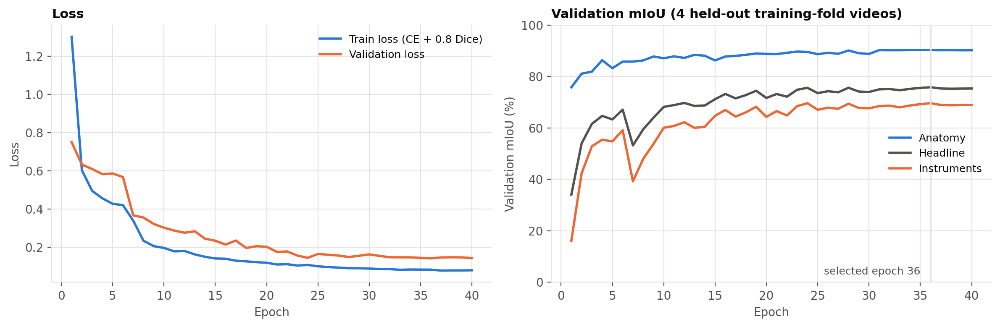
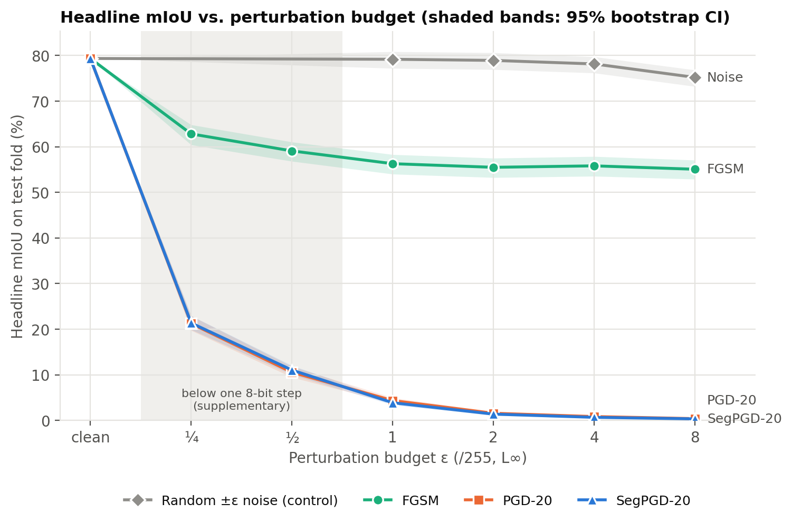
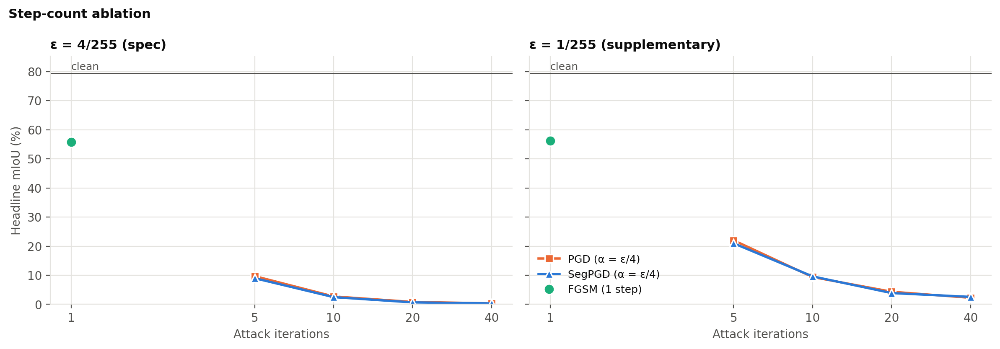
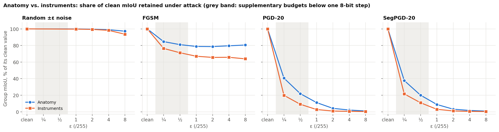
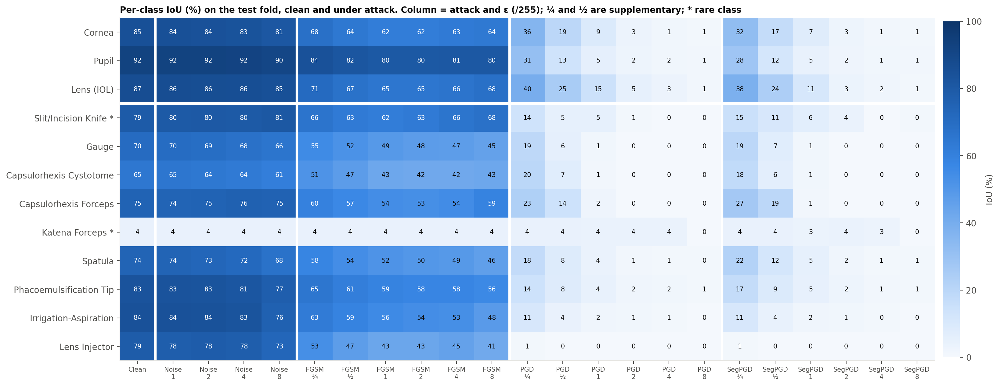
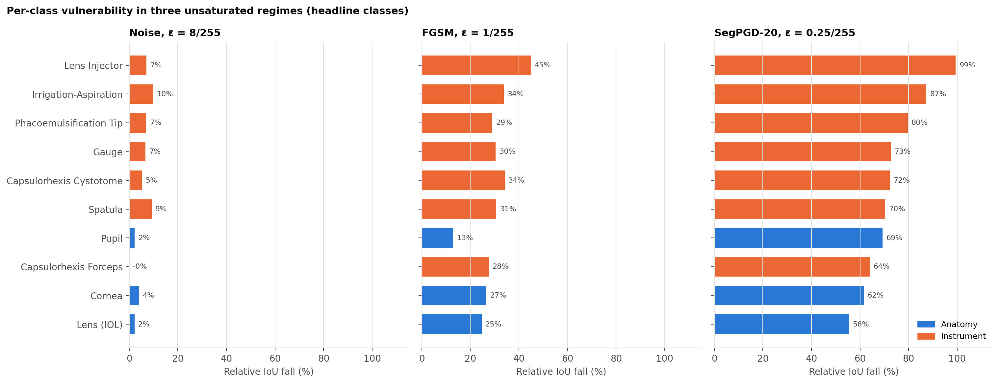
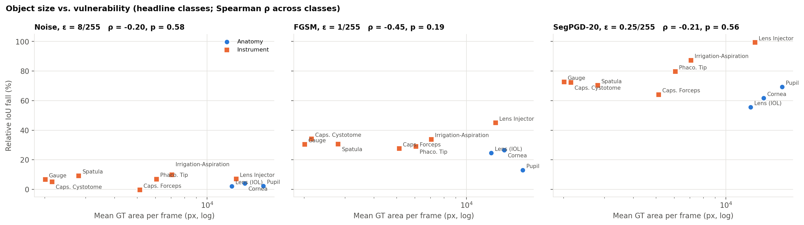
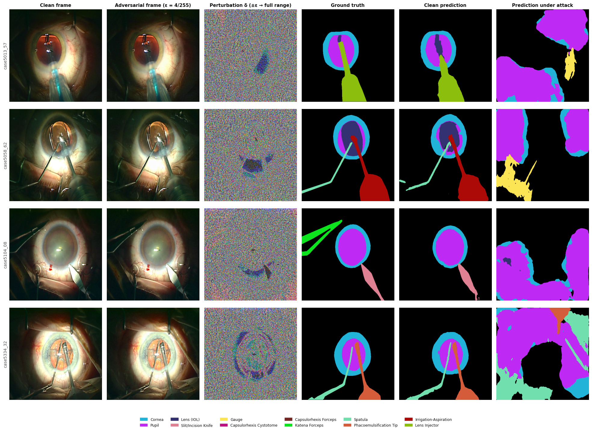
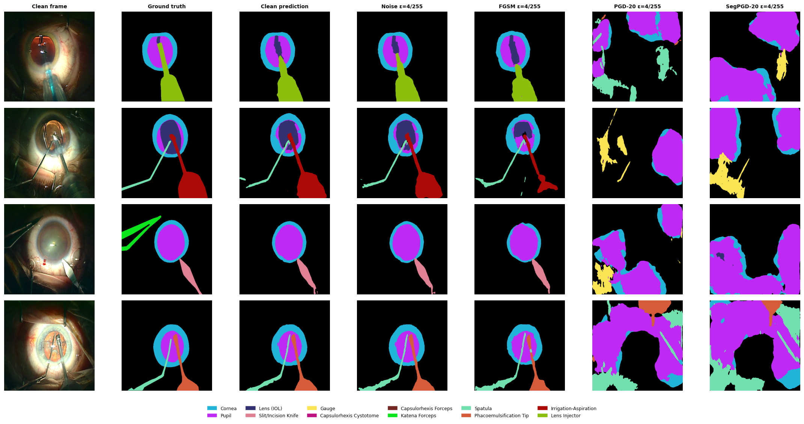
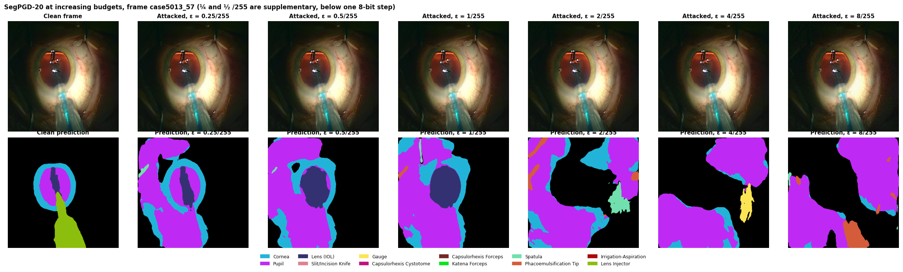

# Results and Verification — Version 1

**Project:** Adversarial Attack and Robustness Analysis of AI-Based Cataract Surgical Instrument Segmentation
**Experiments:** 2–3 October 2026, full Cataract-1K segmentation subset (all 2,256 annotated frames)
**Companions:** [Version 1 spec](Version_1_Cataract_Adversarial_Robustness_Project.md) · [Implementation plan](Implementation_Plan_and_Roadmap.md) · [Gap matrix](Paper_Gap_Matrix.md) · auto-generated tables [results/RESULTS_TABLES.md](results/RESULTS_TABLES.md) · code [README.md](README.md)

Every number below is reproducible from `results/raw/*.npz` with `python analyze_results.py`. Percentages
are IoU/Dice × 100; "pp" = percentage points; ε is in 8-bit units of the [0, 1] RGB input.

---

## 1. Summary of findings

1. **Clean baseline is strong.** DeepLabV3+ (ResNet-50) reaches **79.35% headline mIoU (95% CI 77.34–81.01)
   and 88.27% mean Dice** on the full held-out official Fold 1 (561 frames, 6 patients). Every anatomy class exceeds
   the published Cataract-1K DeepLabV3+ result (iris 84.6 vs 80.0, pupil 92.4 vs 86.2, lens 86.6 vs 77.2).
2. **The model is extremely fragile to adversarial perturbation.** Changing each pixel by **at most one intensity
   level (ε = 1/255, PSNR 51 dB)**, PGD-20 and SegPGD-20 cut headline mIoU from 79.4% to **4.4% and 3.9%** (−95%
   relative). At ε = 8/255 the model is at 0.3–0.4% mIoU. Even ¼ of one intensity level removes 73%.
3. **The damage comes from the adversarial direction, not from noise.** Random ±ε noise costs 0.2% (ε = 1) to 5.2%
   (ε = 8) of mIoU. FGSM costs 29–31% at every spec budget; iterative attacks cost 95–99.6%.
4. **Instruments are more vulnerable than anatomy, consistently.** At every budget where the attack is not saturated,
   instruments lose a larger share of their clean IoU than anatomy: +8 to +17 pp under FGSM, +16 to +21 pp under
   PGD/SegPGD at ¼/255, +3.6 pp under noise at 8/255. Bootstrap CIs exclude zero and **all 6 test videos agree**.
   The gap persists when hallucinated pixels are excluded, so it is genuinely worse segmentation of real instruments.
5. **The attack survives saving to an 8-bit image.** Rounding the adversarial frame to 8-bit pixel values changes
   mIoU by at most 0.26 pp. The result is not a floating-point artefact.
6. **Under iterative attack the model hallucinates rather than going blank.** With SegPGD-20 at 4/255 the model labels
   **49.5% of all pixels as pupil** (ground truth 6.7%) and 6.0% as lens injector (ground truth 0.1%).
7. **More data improved noise robustness but not adversarial robustness.** Compared with the first run on 908 frames,
   the full-data model halves its noise sensitivity (10.3% → 5.2% at 8/255) but is just as fragile to iterative
   attacks (95% fall at 1/255 in both).
8. **SegPGD vs PGD.** At equal steps and budget they reach the same mIoU (within CI), but SegPGD consistently flips
   more correctly-classified pixels (68–77% vs 62–71%), the behaviour its loss is designed for.

---

## 2. What was built, and what was corrected

### 2.1 Pipeline (all code in the project root)

| Stage | File | Notes |
|---|---|---|
| Data download | `download_synapse_dataset.py` | Fetches missing frames from Synapse `syn53395479` (view+download token in `~/.synapseConfig`; MD5-verified) |
| Masks | `convert_supervisely_to_masks.py` | 2,256 Supervisely JSONs → 13-class PNG masks (z-ordered: anatomy, then instruments) |
| Data / split | `cataract_dataset.py` | Official 5 patient-disjoint folds, **fold sizes verified against the paper (561/459/420/385/431)**; Fold 1 = test; 20 train / 4 val videos; zero patient leakage asserted; disk-backed (memory-mapped) frame cache |
| Model | `model_builder.py` | DeepLabV3+ (ResNet-50 ImageNet, OS16, ASPP 6/12/18, low-level decoder), 40.35M params; ImageNet normalisation **inside** the model |
| Loss / metrics | `loss.py`, `metrics.py` | CE + 0.8·Dice; per-frame per-class TP/FP/FN; headline means over a fixed class set |
| Training | `train_baseline.py` | 40 epochs, AdamW, cosine, GPU augmentation, bf16; best epoch by validation mIoU |
| Attacks | `attacks.py` | FGSM, PGD, SegPGD (Gu et al. 2022 schedule), random-sign noise control; L∞ in [0,1] pixel space |
| Experiments | `run_experiments.py` | 41 runs on Fold 1, budget check on every batch, resumable |
| Analysis | `analyze_results.py` | Tables, paired bootstrap CIs, sign tests, per-video consistency, figures |

### 2.2 Corrections to the pre-existing code (found during the audit before training)

| Issue in the earlier code | Effect if left in place | Fix |
|---|---|---|
| `test_fold=1` indexed a 0-based dict, so the test set was the paper's **Fold 2** (459 frames), not Fold 1 (561) | Results not comparable to the published benchmark; spec violated | Folds renumbered 1–5 as in the paper; fold sizes asserted against the paper |
| `model_builder.py` built torchvision **DeepLabV3**, not DeepLabV3+ | Spec / synopsis architecture not implemented | DeepLabV3+ implemented from torchvision ResNet-50 + ASPP with the low-level decoder |
| ImageNet normalisation applied in the dataset | Attack ε would be defined in normalised space, not the spec's [0,1] RGB space | Normalisation moved inside the model; datasets return [0,1] images |
| Dice loss clamped labels before one-hot, so an ignore label (255) became class 12 (Lens Injector) | Padding from geometric augmentation would be trained as Lens Injector | Ignore pixels masked out of both loss terms (unit-tested) |
| Validation used a whole fold (6 videos) | Spec says 20 train / 4 val | 4 validation videos, one per non-test fold |
| mIoU averaged over every class with any prediction, incl. background and classes absent from the ground truth | Under attack, hallucinated absent classes would add zeros and change the class set between clean and attacked runs | Class set fixed from test ground truth; rare classes reported separately (spec §25) |

### 2.3 Data

The first download held only 908 of the 2,256 frame images; Synapse's 1 GB-per-package web limit had truncated it.
The missing 1,348 frames were fetched directly from the Synapse folders (MD5-verified) and checked: 2,256 images,
2,256 annotations and 2,256 masks, pairing one-to-one, all 1024×768. Final split: **1,412 train / 283 val /
561 test**. Every foreground class now occurs in all three splits. The earlier 908-frame run is kept as a
replication check (§4.9; `results_908frames/`, `runs/baseline_908frames/`).

---

## 3. Experimental setup

| Item | Setting |
|---|---|
| Classes | Background, 3 anatomy (Cornea/iris, Pupil, Lens), 9 instruments (Slit+Incision knife merged as in the paper) |
| Headline class set | All 10 non-rare foreground classes: Cornea, Pupil, Lens, Gauge, Capsulorhexis Cystotome, Capsulorhexis Forceps, Spatula, Phaco Tip, Irrigation-Aspiration, Lens Injector. Rare classes (Slit/Incision Knife, 12 test frames; Katena Forceps, 8) reported separately (spec §25) |
| Training | 512×512, batch 8, CE + 0.8 Dice, AdamW (1e-4 encoder / 5e-4 decoder, wd 1e-4), 1-epoch warm-up + cosine, **40 epochs** (54.8 min), flips / affine / colour jitter / blur, seed 42; best epoch 36 (val mIoU 75.82%) |
| Threat model | White-box, untargeted, L∞; δ applied in [0,1] RGB before normalisation; x+δ clipped to [0,1]; attacker uses the ground-truth mask |
| Attacks | FGSM (1 step of size ε); PGD-T (random start, α = ε/4); SegPGD-T (same, loss reweighted with λ_t = (t−1)/2T); random ±ε sign noise (control) |
| Budgets | Spec: ε ∈ {1, 2, 4, 8}/255. Supplementary: ε ∈ {¼, ½}/255 (below one 8-bit step) and 8-bit-rounded versions of ε ∈ {1, 2}/255 |
| Step ablation | T ∈ {5, 10, 20, 40} at ε = 4/255 (spec) and 1/255 (supplementary) |
| Precision | Attacks and all evaluation in fp32 (only training used bf16) |
| Budget check | `check_perturbation` asserts ‖δ‖∞ ≤ ε and x+δ ∈ [0,1] on every batch of every run; measured max ‖δ‖∞ equals ε exactly in every attacked run |
| Statistics | Paired frame bootstrap (2,000 resamples) for CIs; per-frame sign test; per-video consistency count (6 videos); Spearman ρ across classes |

---

## 4. Results

### 4.1 Clean baseline (Fold 1, 561 frames)

| Metric | Value |
|---|---:|
| Headline mIoU (95% CI) | **79.35** (77.34–81.01) |
| Headline mean Dice | **88.27** |
| Anatomy mIoU / Dice | 87.84 / 93.49 |
| Instrument mIoU / Dice (headline instruments) | 75.71 / 86.03 |
| Pixel accuracy | 98.50 |

Per class (IoU %): Cornea 84.6 · Pupil 92.4 · Lens 86.6 · Gauge 70.4 · Capsulorhexis Cystotome 64.6 ·
Capsulorhexis Forceps 75.0 · Spatula 74.4 · Phaco Tip 82.9 · Irrigation-Aspiration 84.1 · Lens Injector 78.6 ·
*rare:* Slit/Incision Knife 79.2 (12 frames), Katena Forceps 4.1 (8 frames; the model largely fails to detect it even
without attack, see Fig. 7 row 3).

**Comparison with the published benchmark** (Cataract-1K, *Sci. Data* 2024, Table 7, DeepLabV3+/ResNet-50):

| Structure | Paper IoU | Ours IoU | Paper Dice | Ours Dice |
|---|---:|---:|---:|---:|
| Iris (dataset label "Cornea") | 79.97 | 84.55 | 88.83 | 91.63 |
| Pupil | 86.24 | 92.42 | 92.61 | 96.06 |
| Lens | 77.23 | 86.55 | 87.12 | 92.79 |
| Instruments (all merged into one class) | 53.53 | 79.34 | 69.67 | 88.48 |

Our baseline meets or exceeds the published DeepLabV3+ on every structure. The comparison is indicative, not
like-for-like: the paper reports a 5-fold average with a different training recipe, and we evaluate the single
official Fold 1. The merged-instrument gap is large and we do not claim to outperform the benchmark in general. The
conclusion we draw is that **the baseline is well trained, so the vulnerability below cannot be blamed on a weak
model.**



### 4.2 Main grid: clean vs. attacked (spec: 1 clean + 12 attacked runs, plus noise control)

| Attack | ε | mIoU % (95% CI) | ΔmIoU pp | Rel. fall % | Robustness ratio | mDice % | Anatomy | Instruments | Correct→wrong % | PSNR dB |
|---|---:|---|---:|---:|---:|---:|---:|---:|---:|---:|
| **Clean** | — | 79.35 (77.34–81.01) | — | — | 1.000 | 88.27 | 87.84 | 75.71 | — | — |
| Noise (control) | 1/255 | 79.17 (77.19–80.84) | 0.18 | 0.2 | 0.998 | 88.16 | 87.78 | 75.48 | 0.1 | 48.2 |
| Noise (control) | 2/255 | 78.93 (76.92–80.61) | 0.43 | 0.5 | 0.995 | 87.99 | 87.53 | 75.24 | 0.2 | 42.2 |
| Noise (control) | 4/255 | 78.15 (76.17–79.72) | 1.20 | 1.5 | 0.985 | 87.50 | 86.98 | 74.36 | 0.4 | 36.2 |
| Noise (control) | 8/255 | 75.20 (73.21–76.82) | 4.15 | 5.2 | 0.948 | 85.58 | 85.38 | 70.84 | 0.7 | 30.2 |
| FGSM | 1/255 | 56.28 (54.00–58.29) | 23.07 | 29.1 | 0.709 | 71.45 | 69.24 | 50.73 | 2.7 | 48.2 |
| FGSM | 2/255 | 55.49 (53.24–57.50) | 23.86 | 30.1 | 0.699 | 70.77 | 69.09 | 49.66 | 2.7 | 42.2 |
| FGSM | 4/255 | 55.81 (53.54–57.87) | 23.54 | 29.7 | 0.703 | 71.03 | 69.92 | 49.76 | 2.6 | 36.2 |
| FGSM | 8/255 | 55.06 (52.89–57.07) | 24.29 | 30.6 | 0.694 | 70.27 | 70.73 | 48.35 | 2.6 | 30.2 |
| PGD-20 | 1/255 | 4.35 (3.71–4.98) | 75.00 | 94.5 | 0.055 | 8.04 | 9.73 | 2.04 | 62.5 | 51.2 |
| PGD-20 | 2/255 | 1.57 (1.25–1.92) | 77.78 | 98.0 | 0.020 | 3.04 | 3.62 | 0.69 | 70.5 | 45.6 |
| PGD-20 | 4/255 | 0.84 (0.60–1.11) | 78.51 | 98.9 | 0.011 | 1.66 | 1.84 | 0.41 | 69.1 | 39.8 |
| PGD-20 | 8/255 | 0.39 (0.24–0.62) | 78.96 | 99.5 | 0.005 | 0.77 | 0.83 | 0.20 | 65.5 | 33.8 |
| SegPGD-20 | 1/255 | 3.88 (3.39–4.42) | 75.47 | 95.1 | 0.049 | 7.28 | 7.71 | 2.24 | 68.2 | 51.2 |
| SegPGD-20 | 2/255 | 1.38 (1.10–1.68) | 77.97 | 98.3 | 0.017 | 2.70 | 2.75 | 0.79 | 76.5 | 45.6 |
| SegPGD-20 | 4/255 | 0.68 (0.49–0.93) | 78.67 | 99.1 | 0.009 | 1.34 | 1.41 | 0.36 | 75.7 | 39.7 |
| SegPGD-20 | 8/255 | 0.34 (0.23–0.52) | 79.01 | 99.6 | 0.004 | 0.68 | 0.71 | 0.18 | 74.0 | 33.8 |



**Reading the grid.**

- **Noise vs. gradient attacks.** At ε = 1/255 the noise control and FGSM have *identical* PSNR (48.2 dB, every pixel
  moved by exactly ±1/255), yet noise costs 0.2% of mIoU and FGSM 29%. The vulnerability is directional, not a
  general sensitivity to small perturbations.
- **FGSM plateaus.** FGSM's damage barely grows with ε (29.1 → 30.1 → 29.7 → 30.6%). A single linear step stops gaining
  once the loss surface curves; a larger budget does not substitute for iterations.
- **Iterative attacks saturate at the smallest specified budget.** PGD-20 and SegPGD-20 already remove 95% of mIoU at
  ε = 1/255. That is why the supplementary sub-8-bit budgets were added (§4.6).
- **PGD perturbations are less visible than FGSM's at the same ε** (51.2 vs 48.2 dB at 1/255): PGD does not push every
  pixel to ±ε, yet it does about 3× the damage.

### 4.3 Which attack is stronger, and does iteration count matter?

**Step-count ablation at ε = 4/255 (spec)** — headline mIoU %:

| Steps | 1 (FGSM) | 5 | 10 | 20 | 40 |
|---|---:|---:|---:|---:|---:|
| PGD | 55.81 | 9.71 | 2.73 | 0.84 | 0.34 |
| SegPGD | — | 8.99 | 2.48 | 0.68 | 0.33 |
| PGD correct→wrong % | 2.6 | 21.7 | 45.8 | 69.1 | 85.3 |
| SegPGD correct→wrong % | — | 25.0 | 51.2 | 75.7 | 91.2 |

**Same ablation at ε = 1/255 (supplementary)**, where the attacks are less saturated:

| Steps | 1 (FGSM) | 5 | 10 | 20 | 40 |
|---|---:|---:|---:|---:|---:|
| PGD | 56.28 | 22.01 | 9.38 | 4.35 | 2.24 |
| SegPGD | — | 20.97 | 9.61 | 3.88 | 2.57 |
| PGD correct→wrong % | 2.7 | 15.0 | 37.1 | 62.5 | 80.1 |
| SegPGD correct→wrong % | — | 17.7 | 42.0 | 68.2 | 86.1 |



- Five PGD steps at one intensity level already do more damage (−72% relative) than FGSM at eight levels (−31%).
- Damage keeps increasing up to 40 steps, so **20-step results are conservative**: they are an upper bound on the
  model's robustness, as the SEA paper (P11) requires robustness numbers to be read.
- SegPGD and PGD reach statistically indistinguishable mIoU at every step count, but SegPGD consistently converts
  3–7 pp more of the correctly-classified pixels. On this model plain PGD is already strong enough to collapse mIoU,
  so the segmentation-aware reweighting shows up in pixel-flip rate rather than in mIoU.

### 4.4 Anatomy vs. instruments (spec RQ3; the project's novelty claim)

| Attack | ε | Anatomy rel. fall % | Instrument rel. fall % | Difference pp (95% CI) | Videos where instruments fall further |
|---|---:|---:|---:|---|---:|
| Noise | 8/255 | 2.8 | 6.4 | +3.6 (+2.2 to +5.1) | 6/6 |
| FGSM | ¼/255 † | 15.3 | 23.6 | +8.2 (+5.2 to +11.2) | 6/6 |
| FGSM | 1/255 | 21.2 | 33.0 | +11.8 (+8.5 to +15.1) | 6/6 |
| FGSM | 8/255 | 19.5 | 36.1 | +16.7 (+13.4 to +20.0) | 6/6 |
| PGD-20 | ¼/255 † | 59.4 | 80.1 | +20.7 (+16.8 to +24.2) | 6/6 |
| PGD-20 | ½/255 † | 78.1 | 91.0 | +12.8 (+9.8 to +15.6) | 6/6 |
| PGD-20 | 1/255 | 88.9 | 97.3 | +8.4 (+6.4 to +10.3) | 6/6 |
| PGD-20 | 8/255 | 99.1 | 99.7 | +0.7 (+0.2 to +1.5) | 4/6 |
| SegPGD-20 | ¼/255 † | 62.3 | 78.4 | +16.1 (+12.5 to +19.6) | 6/6 |
| SegPGD-20 | ½/255 † | 80.0 | 89.1 | +9.1 (+6.3 to +11.8) | 6/6 |
| SegPGD-20 | 1/255 | 91.2 | 97.0 | +5.8 (+4.2 to +7.4) | 6/6 |
| SegPGD-20 | 8/255 | 99.2 | 99.8 | +0.6 (+0.2 to +1.2) | 5/6 |

† supplementary budget below one 8-bit step. Full table with every budget, absolute drops and per-frame sign tests:
`results/RESULTS_TABLES.md` §T4.



**Is it real segmentation failure or hallucination?** Pooled IoU also charges a class for pixels hallucinated in
frames where it does not occur. Scoring each class only on frames where it is present:

| Attack | ε | Difference pp, present-frames only | Difference pp, pooled |
|---|---:|---:|---:|
| FGSM | 1/255 | +10.2 | +11.8 |
| PGD-20 | ¼/255 | +14.6 | +20.7 |
| PGD-20 | 1/255 | +7.8 | +8.4 |
| SegPGD-20 | ¼/255 | +12.5 | +16.1 |
| SegPGD-20 | 1/255 | +6.0 | +5.8 |

**Interpretation.**

- **The effect is consistent across attack types.** Wherever the attack is not saturated (noise at 8/255, FGSM at
  every budget, PGD/SegPGD up to 2/255), instruments lose a larger share of their clean IoU than anatomy. The bootstrap
  CIs exclude zero, the per-frame sign tests give p ≤ 0.025 (p < 0.001 in all but one setting), and **all six test
  videos agree**.
- **It is mostly real segmentation failure.** Excluding hallucinated pixels shrinks the gap at ¼/255 (+20.7 → +14.6
  pp for PGD), so hallucination contributes, but a large gap remains (+6 to +15 pp). The attacked model segments the
  *real* instruments worse than the real anatomy.
- **At saturation the distinction disappears.** At ε ≥ 4/255 both groups are at ~0 and the gap shrinks to ≤ 1.6 pp.
  Everything fails.
- **Absolute vs. relative.** Under strong iterative attacks anatomy loses *more absolute* IoU (≈ 86 pp vs ≈ 75 pp)
  simply because it starts higher. The project's hypothesis concerns how fast each group degrades, so relative fall
  is the primary measure; both are tabulated.
- **Statistical caution.** Frames from one video are correlated, so per-frame tests overstate certainty. The
  six-video count is the conservative evidence, and it is unanimous in every unsaturated setting.

### 4.5 Per-class vulnerability and the "thin metallic tools" hypothesis





- **The three anatomy classes are the least affected in every regime.** Under FGSM at 1/255: Pupil −13%, Lens −25%,
  Cornea −27%, against −28% to −45% for instruments (Lens Injector −45%, Irrigation-Aspiration −34%, Cystotome −34%).
  Under SegPGD-20 at ¼/255: Lens −56%, Cornea −62%, Pupil −69%, against −64% to −99% for instruments (Lens
  Injector −99%, Irrigation-Aspiration −87%, Phaco Tip −80%).
- **One instrument behaves like anatomy.** Capsulorhexis Forceps is consistently among the most robust classes
  (−0% under noise, −28% FGSM, −64% SegPGD-¼), despite being thin and metallic.
- **Object-size correlation.** Across the 10 headline classes, the Spearman correlation between mean object area and
  relative fall is negative in every non-trivial run (ρ = −0.14 to −0.56, under noise, FGSM and the iterative
  attacks alike): smaller structures tend to fall further. With 10 classes **none of these correlations is
  statistically significant** (smallest p = 0.09).



**Verdict on the hypothesis "thin, specular metallic tools degrade faster under small noise caps":**

- **Supported at the group level.** Instruments degrade faster than anatomy under every attack type at small
  budgets, with CIs excluding zero, unanimous across videos, and not explained by hallucination (§4.4).
- **Size is a plausible but unproven explanation.** The size–vulnerability correlation has a consistent negative sign
  but is not significant with 10 classes. Capsulorhexis Forceps, a thin tool that stays robust, shows that thinness
  alone does not determine vulnerability.

### 4.6 Supplementary: below one 8-bit step, and 8-bit quantisation

**Why these runs exist.** The spec's smallest budget (1/255) already saturates PGD/SegPGD. Two questions follow:
where does the collapse actually begin, and does the attack still work once the adversarial frame is saved as an
ordinary 8-bit image?

**(a) Budgets below one 8-bit step.** These perturbations exist only in floating point, i.e. for an attacker who can
modify decoded frames in memory.

| Attack | ε | mIoU % (95% CI) | Rel. fall % | Correct→wrong % |
|---|---:|---|---:|---:|
| FGSM | ¼/255 | 62.81 (60.41–64.81) | 20.8 | 1.9 |
| FGSM | ½/255 | 59.08 (56.81–61.04) | 25.5 | 2.4 |
| PGD-20 | ¼/255 | 21.23 (19.72–22.92) | 73.2 | 23.9 |
| PGD-20 | ½/255 | 10.56 (9.46–11.81) | 86.7 | 44.9 |
| SegPGD-20 | ¼/255 | 21.36 (19.90–22.95) | 73.1 | 26.3 |
| SegPGD-20 | ½/255 | 11.03 (10.03–12.03) | 86.1 | 50.0 |

Even a quarter of one intensity level removes 73% of mIoU with 20 iterations. The ε curve (Fig. 1) is steepest
*below* the spec's range: the model has no meaningful robustness margin at any budget an 8-bit attacker can use.

**(b) 8-bit quantisation.** The adversarial frame is rounded to the 8-bit grid before inference. Clean frames are
already on that grid, so ‖δ‖∞ ≤ ε still holds (measured exactly ε).

| Attack | ε | mIoU % float | mIoU % 8-bit |
|---|---:|---:|---:|
| FGSM | 1/255 | 56.28 | 56.28 |
| FGSM | 2/255 | 55.49 | 55.48 |
| PGD-20 | 1/255 | 4.35 | 4.09 |
| PGD-20 | 2/255 | 1.57 | 1.65 |
| SegPGD-20 | 1/255 | 3.88 | 3.75 |
| SegPGD-20 | 2/255 | 1.38 | 1.53 |

Rounding changes mIoU by at most 0.26 pp. **The headline result holds for adversarial frames stored as standard 8-bit
images.**

### 4.7 What the model predicts under attack

| Class | Ground truth | Clean | Noise 8/255 | FGSM 4/255 | PGD-20 4/255 | SegPGD-20 4/255 |
|---|---:|---:|---:|---:|---:|---:|
| Background | 84.8 | 84.9 | 85.1 | 85.1 | 40.3 | 33.6 |
| Cornea | 5.5 | 5.5 | 5.5 | 5.5 | 5.6 | 6.3 |
| Pupil | 6.7 | 6.6 | 6.7 | 6.8 | 43.7 | 49.5 |
| Lens (IOL) | 0.9 | 0.9 | 0.9 | 0.8 | 0.4 | 0.4 |
| Slit/Incision Knife | 0.0 | 0.0 | 0.0 | 0.0 | 1.3 | 0.6 |
| Gauge | 0.1 | 0.1 | 0.1 | 0.1 | 1.1 | 0.6 |
| Spatula | 0.4 | 0.4 | 0.3 | 0.3 | 0.9 | 1.1 |
| Lens Injector | 0.1 | 0.1 | 0.1 | 0.1 | 5.4 | 6.0 |

(Share of all test pixels, %; remaining classes ≤ 1.1% in every column, full table in `RESULTS_TABLES.md` §T7.)
**FGSM** leaves the class proportions unchanged while removing 30% of the mIoU: it *mislocalises and confuses*
structures. **PGD/SegPGD** make the model *hallucinate*. Almost half the frame becomes "pupil" and about 6% becomes
"lens injector", an instrument present in only 14 test frames. For any downstream use (tool tracking, phase
recognition, skill metrics), confident false structures are a worse failure than an empty mask.

### 4.8 Qualitative examples







Columns in Fig. 7: clean frame, adversarial frame, perturbation (rescaled from ±ε to the full range so it is
visible), ground truth, clean prediction, prediction under attack. The adversarial frames are visually
indistinguishable from the clean ones, yet the predictions turn into large hallucinated "pupil", "gauge" and "spatula"
regions, the pattern quantified in §4.7. Row 3 also shows a clean-model miss: the Katena forceps (green, top left of
the ground truth) is not detected even without attack, which is why that rare class scores 4% clean IoU.

### 4.9 Replication: the first run on 908 frames

The pipeline was first run on a partial download (908 frames: 524 train / 259 test, 80 epochs). Its full write-up is
archived in `results_908frames/`. Comparing the two runs shows which conclusions are robust:

| Measure | 908-frame run | Full data | Same conclusion? |
|---|---:|---:|---|
| Clean headline mIoU | 77.08 | 79.35 | ✔ competent baseline |
| Noise 8/255, rel. fall | 10.3% | 5.2% | — more data halved noise sensitivity |
| FGSM 1/255, rel. fall | 34.0% | 29.1% | ✔ ~⅓ loss, flat in ε |
| PGD-20 1/255, mIoU (rel. fall) | 3.85 (95.0%) | 4.35 (94.5%) | ✔ collapse at one intensity level |
| SegPGD-20 1/255, mIoU (rel. fall) | 3.74 (95.1%) | 3.88 (95.1%) | ✔ |
| 8-bit rounding, max change | 0.37 pp | 0.26 pp | ✔ survives quantisation |
| Hallucination under SegPGD-20 4/255 (pupil share) | 41.2% | 49.5% | ✔ |
| Instrument − anatomy gap, FGSM 1/255 | +9.7 pp, 6/6 videos | +11.8 pp, 6/6 videos | ✔ |
| Instrument − anatomy gap, PGD-20 ¼/255 | +8.7 pp, 4/6 videos, sign test p = 0.55 | +20.7 pp, 6/6 videos, p < 0.001 | ✘ weak → strong |
| Size–vulnerability ρ under iterative ¼/255 | +0.40 / +0.60 | −0.25 / −0.21 | ✘ sign flipped |

Every headline vulnerability result replicates. Two findings changed with 2.7× more training data and 2.2× more test
frames, and the full-data results supersede the 908-frame ones in both cases. First, the anatomy/instrument asymmetry
under iterative attacks, inconclusive on 908 frames, is clear on the full data. Second, the apparent reversal of the
size effect under iterative attacks did not replicate. More training data made the model more robust to random noise
but not to adversarial perturbation.

---

## 5. Answers to the research questions (spec §6)

**Primary — How do adversarial attacks affect the performance and robustness of the model?**
Catastrophically and at very small budgets. A white-box iterative attack with ε = 1/255 (one intensity level, 51 dB
PSNR) removes 95% of the headline mIoU (79.4% → 3.9–4.4%), and the attack survives being saved as an 8-bit image. At
8/255 the model is at 0.3–0.4%. A single-step attack removes about 30%. Random noise of the same budget removes at
most 5%.

| # | Supporting question | Answer | Evidence |
|---|---|---|---|
| 1 | How much does performance decrease? | ΔmIoU 23–24 pp (FGSM), 75–79 pp (PGD-20 / SegPGD-20); mDice falls from 88.3% to 70–71% (FGSM) and 0.7–8% (iterative) | §4.2 |
| 2 | Which attack settings degrade most? | Iterations matter far more than budget: SegPGD ≈ PGD ≫ FGSM ≫ noise. More steps keep helping up to 40. FGSM barely improves with ε | §4.2, §4.3 |
| 3 | Are some instruments / conditions more vulnerable? | Yes. Instruments lose a larger share of IoU than anatomy at every unsaturated budget of every attack (+3.6 to +20.7 pp; all 6 videos), mostly from genuine segmentation failure, not hallucination. Lens Injector and Irrigation-Aspiration are the most fragile classes; Capsulorhexis Forceps and the anatomy classes are the most robust. Smaller structures tend to fall further (consistent sign, not significant over 10 classes) | §4.4, §4.5 |
| 4 | Clean vs. adversarial comparison? | 79.35% → 55.1–56.3% (FGSM), 0.3–4.4% (iterative) headline mIoU; full per-class tables | §4.2, T3 |
| 5 | Perturbation magnitude vs. degradation trade-off? | Strongly non-linear. Iterative attacks remove 73% of mIoU at ¼/255 and 95% at 1/255, then flatten. FGSM reaches its ~30% plateau by 1/255 and does not improve with ε. Noise grows slowly (0.2% → 5.2% from 1 to 8/255). Results unchanged after 8-bit rounding | §4.2, §4.6, Fig. 1 |

---

## 6. Verification against the problem statement and plan

**Problem statement (spec §3):** *"How vulnerable is an AI-based cataract surgical instrument segmentation model to
adversarial perturbations, and how significantly do such attacks affect its performance?"* — **Answered** (§1, §5),
quantitatively, on the complete official held-out fold, with confidence intervals, a no-gradient control, 8-bit
validation, and a replication on an independent data subset.

### 6.1 Specific objectives (spec §7)

| # | Objective | Status | Where |
|---|---|---|---|
| 1 | Study existing research | Done earlier | Literature pool, gap matrix |
| 2 | Select dataset and model | Done | Cataract-1K seg. subset (all 2,256 frames); DeepLabV3+ / ResNet-50 |
| 3 | Clean baseline | **Done**: 79.35% mIoU, 88.27% mDice; meets or exceeds the published DeepLabV3+ | §4.1 |
| 4 | Implement attacks | **Done**: FGSM, PGD, SegPGD (+ noise control), unit-tested | `attacks.py` |
| 5 | Generate adversarial examples | **Done**: 40 attacked runs × 561 frames | `results/raw/` |
| 6 | Evaluate on adversarial inputs | **Done**: same model, same metrics, fp32 | §4.2 |
| 7 | Quantify degradation | **Done**: ΔmIoU, relative fall, robustness ratio, mDice, correct→wrong, paired CIs | §4.2 |
| 8 | Attack strength vs. degradation | **Done**: 4 spec + 2 supplementary budgets, step ablation at two budgets | §4.2, §4.3, §4.6 |
| 9 | Vulnerability patterns | **Done**: anatomy vs instruments, per class, object size, hallucination analysis | §4.4–§4.7 |
| 10 | Document findings and limitations | **Done**: this document | §7 |

### 6.2 Locked decisions (spec §25) and plan milestones

| Requirement | Status |
|---|---|
| DeepLabV3+, ImageNet ResNet-50, OS16, 13 channels, 512×512 | ✔ (earlier code used DeepLabV3; corrected) |
| Official patient-disjoint folds, Fold 1 test, 20 train / 4 val videos | ✔ (earlier code tested on Fold 2; corrected) |
| White-box, untargeted, L∞, perturbation in [0,1] RGB before normalisation, clipped | ✔ checked on every batch |
| FGSM; PGD-20 (α = ε/4, random start); SegPGD-20 as primary | ✔ |
| ε ∈ {1, 2, 4, 8}/255 → 12 attacked + 1 clean | ✔ (+4 noise controls) |
| Step ablation {5, 10, 20, 40} at 4/255 for PGD and SegPGD | ✔ (+ same at 1/255) |
| mIoU and mean Dice headline; per-class IoU always reported; rare classes separate | ✔ |
| Absolute and relative degradation, robustness ratio, mIoU-vs-ε curves | ✔ |
| Anatomy vs instrument comparison | ✔ with CIs, per-video consistency, hallucination control |
| Clean baseline within published range (plan, Phase 2) | ✔ meets or exceeds every published DeepLabV3+ value (not like-for-like, §4.1) |
| 40 training epochs (plan, Phase 2) | ✔ |
| Unit-test perturbation clipping (plan, 18 Oct) | ✔ `python attacks.py` + runtime assertion |
| Publication-quality panels: clean, perturbed, difference map, clean pred, attacked pred (plan, 4 Nov) | ✔ Fig. 7–9 |
| Code documentation, requirements, fixed seeds, README (plan, Phase 5) | ✔ |
| No defences / adversarial training (spec §28) | ✔ none added |
| Final thesis-format report and slide deck (plan, Phase 5–6) | **Not done here.** This document and `results/` supply the material |

---

## 7. Limitations and threats to validity

1. **One fold, one seed, one architecture.** Fold 1 only, as the spec specifies; no cross-fold variance and no second
   architecture (the optional UNet++ arm was not run). The 908-frame replication (§4.9) partly offsets this.
2. **Correlated frames.** Bootstrap CIs and per-frame sign tests treat frames as independent; frames from the same
   video are not. The six-video consistency counts are the conservative evidence.
3. **Rare classes.** Slit/Incision Knife (12 test frames) and Katena Forceps (8) are too sparse for firm per-class
   conclusions, and Katena is barely segmented even on clean frames (4.1% IoU).
4. **Attack strength is a lower bound.** Damage was still rising from 20 to 40 steps. Measured mIoU under attack is an
   upper bound on robustness, never proof of it (P11, SEA).
5. **Threat model.** White-box, digital, untargeted, with ground-truth labels available to the attacker. This is the
   worst case by design, not a realistic operating-room attack. Black-box, transfer, physical and temporal (video)
   attacks are Version 2.
6. **Sub-8-bit budgets** (¼, ½ /255) cannot be stored in an 8-bit image; they apply only to an attacker who modifies
   decoded frames in memory. The 8-bit-rounded runs address the stored-image case.
7. **Benchmark comparison** with the paper is not like-for-like (single fold vs 5-fold mean, different recipe).
8. **Timing figures are wall-clock** and were affected by GPU sharing with other applications and, for one run,
   a system sleep (flagged ‡ in `RESULTS_TABLES.md` T5). No attack result depends on timing.
9. **No clinical claims.** These are laboratory measurements on recorded frames. They say nothing directly about
   patient safety.

---

## 8. Deviations from the plan, and why

| Deviation | Reason |
|---|---|
| Random ±ε noise control added | Separates "any small perturbation" from "adversarial direction"; without it the degradation is uninterpretable |
| Sub-8-bit budgets (¼, ½ /255) and 8-bit-rounded runs added | Iterative attacks saturated already at the smallest spec budget, leaving the ε-curve and the anatomy/instrument comparison with no unsaturated iterative points |
| Step ablation also at 1/255 | Same reason: to see the step effect where the attack has not yet saturated |
| Prediction-composition table and present-frames-only check added | Explain *how* the model fails (hallucination vs mislocalisation) and whether the instrument gap is real |
| Initial run on a 908-frame partial download, kept as replication | The first download was truncated by Synapse's 1 GB package limit; the run was repeated on all 2,256 frames |

All additions are measurements; none is a defence, so Version-1 scope (spec §28) is preserved.

---

## 9. Reproduce

```bash
python download_synapse_dataset.py
```

```bash
python train_baseline.py --epochs 40
```

```bash
python run_experiments.py
```

```bash
python analyze_results.py
```

On an RTX 3060 Laptop GPU (6 GB): training ≈ 55 min; the 41-run grid ≈ 5–6 h of attack compute on 561 frames
(longer when the GPU is shared with other applications); analysis ≈ 1 min on the CPU.
